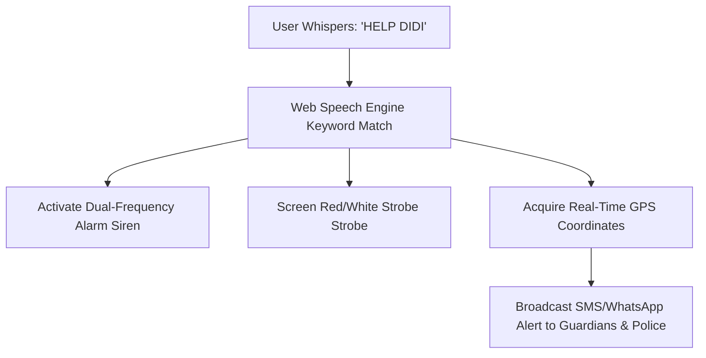

# 💍 Suraksha Ring — AI Wearable & Emergency Alarm Web Application

> **Next-Generation AI Wearables for Women's Security & Emergency Response**

[](https://vitejs.dev/)
[](https://reactjs.org/)
[](https://tailwindcss.com/)
[](LICENSE)

---

## 🌟 Overview

**Suraksha Ring** is a discreet, voice-activated smart ring and emergency web application designed to empower women's security. It continuously listens for emergency voice triggers (e.g. `"HELP DIDI"`, `"EMERGENCY"`, `"SAVE ME"`) and instantly executes an automated SOS sequence: sounding a 90dB dual-frequency emergency alarm siren, flashing a high-intensity visual strobe, capturing live GPS telemetry, and broadcasting instant alert links to guardians and police dispatch.

---

## 🚀 Key Features

* 🎙️ **Live Voice SOS Guardian**: Continuous browser-based voice detection for custom trigger phrases (`"HELP DIDI"`, `"SAVE ME"`, `"EMERGENCY"`, `"SURAKSHA"`).
* 🚨 **Dual-Oscillator Mobile Siren**: Web Audio API synthesizer generating an escalating dual-frequency (600Hz $\leftrightarrow$ 1400Hz) alarm siren tone directly through phone speakers.
* ⚡ **Visual Emergency Strobe**: High-intensity screen flasher with a 5-second countdown timer and a false-alarm cancellation protocol.
* 📍 **Precision GPS & Telemetry**: Captures real-time latitude/longitude coordinates and generates shareable Google Maps location links.
* 📱 **Direct Guardian Alert Dispatch**: Configurable emergency contact list with one-tap SMS/WhatsApp distress message links.
* 💸 **Government Subsidy Integration**: Built-in eligibility calculator for ₹750 national women safety scheme subsidies.

---

## 🛠️ Technology Stack

| Layer | Technology |
| :--- | :--- |
| **Framework** | [React 18](https://reactjs.org/) + [Vite 5](https://vitejs.dev/) |
| **Styling** | [Tailwind CSS 3.4](https://tailwindcss.com/) + Custom Glassmorphism |
| **Animations** | [Framer Motion 11](https://framer-motion.dev/) |
| **Icons** | [Lucide React](https://lucide.dev/) |
| **Voice Recognition** | Native Web Speech API (`SpeechRecognition`) |
| **Sound Synthesizer** | Native Web Audio API (`AudioContext` Oscillators) |

---

## ⚡ Emergency Protocol Flow



---

## 🛠️ Getting Started

### Prerequisites
* **Node.js** (v18.0.0 or higher)
* **npm** (v9.0.0 or higher)

### Installation

1. **Clone the repository**:
   ```bash
   git clone https://github.com/sheevu/suraksha-ring.git
   cd suraksha-ring
   ```

2. **Install dependencies**:
   ```bash
   npm install
   ```

3. **Start the local development server**:
   ```bash
   npm run dev
   ```
   Open your browser at `http://localhost:5173/`

4. **Build for production**:
   ```bash
   npm run build
   ```

---

## 📁 Directory Structure

```text
suraksha-ring/
├── src/
│   ├── components/
│   │   ├── Navbar.jsx               # Navigation bar & live SOS link
│   │   ├── Hero.jsx                 # Product hero banner & float rings
│   │   ├── VoiceSOSConsole.jsx      # Voice listener & alarm siren engine
│   │   ├── VoiceActivationFlow.jsx  # Interactive step-by-step protocol demo
│   │   ├── Features.jsx             # Military-grade hardware features grid
│   │   ├── TechSpecs.jsx            # Titanium, IP68 & battery specs
│   │   ├── PreOrderModal.jsx        # Reservation modal & subsidy check
│   │   ├── VideoModal.jsx           # Live telemetry video demonstration
│   │   ├── CTA.jsx                  # Pre-order call-to-action banner
│   │   └── Footer.jsx               # Certification details & emergency helplines
│   ├── App.jsx                      # Main app container
│   ├── main.jsx                     # Vite React entry point
│   └── index.css                    # Tailwind CSS base styles
├── package.json
├── tailwind.config.js
├── vite.config.js
└── README.md
```

---

## 📄 License

This project is open source and available under the [MIT License](LICENSE).
